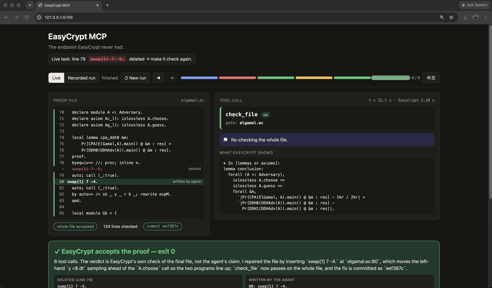

# easy-crypt-mcp



[EasyCrypt](https://github.com/EasyCrypt/easycrypt) checks cryptographic proofs by machine. It
normally runs through an Emacs front-end, which leaves an AI agent no way to load a proof, read
the open goals or test a tactic. This repo adds that missing interface:

- **an MCP server** with six tools that wrap EasyCrypt's batch CLI (`easycrypt llm`);
- **a Claude Code skill** that teaches the agent how to drive a proof with those tools;
- **a live demo**: delete any line of a real proof on stage, then watch an agent repair it step by
  step until EasyCrypt accepts the file.

The `.ec` file holds all the state. Every tool call re-checks the file from line 1, so the server
keeps nothing in memory and the file's git history records what the agent did.
[ARCHITECTURE.md](ARCHITECTURE.md) explains the design and what was verified against the real
binary.

---

## Repository layout

| Path | What it is |
|---|---|
| [`easycrypt_core.py`](easycrypt_core.py) | The core module. It runs `easycrypt llm`, parses diagnostics and goals, patches temp copies, and makes git commits. The other entry points import it. |
| [`mcp_server.py`](mcp_server.py) | The MCP server that agents connect to. It exposes the six tools below. |
| [`http_api.py`](http_api.py) | Optional REST wrapper around the same functions, for manual testing (FastAPI, `/docs`). |
| [`.claude/skills/easycrypt-prover/SKILL.md`](.claude/skills/easycrypt-prover/SKILL.md) | The skill. It holds the proof strategy the agent follows. |
| [`.mcp.json`](.mcp.json), [`bin/easycrypt-mcp`](bin/easycrypt-mcp) | Registers the MCP server (in Docker) when this repo is opened in Claude Code. |
| [`bin/ec-call`](bin/ec-call) | Calls a single tool from the shell through the real MCP server. |
| [`Dockerfile`](Dockerfile), [`.github/workflows/image.yml`](.github/workflows/image.yml) | Builds the EasyCrypt + server image. CI publishes it to `ghcr.io/davidscode404/easy-crypt-mcp`. |
| [`proofs/elgamal.ec`](proofs/elgamal.ec) | ElGamal IND-CPA proof with the `cpa_ddh0` proof left empty, as a task for the agent. |
| [`demo/elgamal.ec`](demo/elgamal.ec) | The complete, checked ElGamal proof. The live demo deletes lines from this file. |
| [`demo/repair/`](demo/repair) | The live "delete a line, watch it get repaired" demo: backend, page and a recorded run. |
| [`demo/replay/`](demo/replay) | Side-by-side replay of an agent with the MCP tools vs. without them. |
| [`examples/`](examples) | Two tiny smoke-test proofs, one closed and one with an open goal. |
| [`tests/`](tests) | `test_smoke.py` uses a fake binary and runs anywhere. `test_real.py` needs real EasyCrypt. |
| [`scripts/ec-docker`](scripts/ec-docker) | Runs `easycrypt` inside the image with the current directory mounted, for `EASYCRYPT_BIN=scripts/ec-docker` (the live demo without a native install). |

---

## The MCP tools

All six are defined in [`mcp_server.py`](mcp_server.py) and implemented in
[`easycrypt_core.py`](easycrypt_core.py). The four proof tools (`check_file`, `goals_at`,
`try_snippet`, `apply_snippet`) return `{ok, exit_code, diagnostics, goals, note, commit, raw_stderr}`.

| Tool | What it does |
|---|---|
| `easycrypt_config()` | Reports the EasyCrypt version and the SMT solvers it found (Alt-Ergo, Z3, CVC5). Called once at the start. |
| `check_file(path)` | Checks the whole file. On failure it returns the first error (`line`, `message`) and the goals still open there. |
| `goals_at(path, line)` | Shows the proof state just **before** `line` runs: the hypotheses, the goal and, for program goals, both programs side by side. |
| `try_snippet(path, snippet, line)` | Inserts tactics before `line` in a **temp copy**, checks up to the end of the snippet, and returns the new goals. The real file is not touched. |
| `apply_snippet(path, snippet, line)` | Runs the same check. If it passes, it writes exactly those bytes into the real file and `git commit`s them, so each accepted step is one commit. |
| `search_lib(pattern)` | Greps EasyCrypt's standard library for a lemma or definition (declarations first). |

Environment variables (all optional):

| Variable | Default | Purpose |
|---|---|---|
| `EASYCRYPT_BIN` | `easycrypt` | Path to the EasyCrypt binary. |
| `EASYCRYPT_ARGS` | *(empty)* | Extra flags for every check, e.g. `-timeout 10` (SMT timeout) or `-p Z3`. |
| `EASYCRYPT_ROOT` | *(none)* | Only files inside this folder may be checked. |
| `EASYCRYPT_WALL` | `120` | Hard time limit per call, in seconds. |

## The skill

[`.claude/skills/easycrypt-prover/SKILL.md`](.claude/skills/easycrypt-prover/SKILL.md) is loaded by
Claude Code whenever a `.ec` file has to be proved or repaired. It holds the strategy; the server
has none. The skill tells the agent:

- **Ground rules:** never edit a `.ec` file directly. Test with `try_snippet` first, then commit
  with `apply_snippet`. Close goals with `by …` so a failure shows up on its own line. Work on one
  goal at a time, with a budget of 6 attempts per goal and 30 per lemma.
- **The loop:** `check_file` → `goals_at` the first error → pick a tactic → `try_snippet` →
  `apply_snippet` → repeat.
- **Tactic ladders:** for ambient goals (`smt`, `auto`, `rewrite`, `ring`, …) and for program
  goals (`byequiv`, `proc`, `inline`, `swap`, `call`, `rnd` with a bijection, `seq`, `conseq`, …).
- **Finding lemmas:** with `print <Theory>.` and `search_lib`.
- **When it is stuck:** stop and write a precise handoff report (goal, tactics tried, what seems
  to be missing) instead of looping.

---

## Setup

There are two ways to run EasyCrypt. Pick one.

### Option A: Docker (simplest for using the tools from Claude Code)

Needs [Docker](https://docs.docker.com/get-docker/) and
[Claude Code](https://docs.claude.com/en/docs/claude-code).

```bash
docker pull ghcr.io/davidscode404/easy-crypt-mcp:main
```
```bash
docker tag ghcr.io/davidscode404/easy-crypt-mcp:main easycrypt-mcp
```
```bash
docker run --rm --platform linux/amd64 easycrypt-mcp easycrypt config
```

The last command should list Alt-Ergo, Z3 and CVC5. If the pull fails, build the image yourself
(5–10 minutes). The build finishes by checking one proof that should pass and one that should fail:

```bash
docker build --platform linux/amd64 -t easycrypt-mcp .
```

Then open this repo in Claude Code. [`.mcp.json`](.mcp.json) registers the server through
[`bin/easycrypt-mcp`](bin/easycrypt-mcp); approve it when asked. To use the tools on proofs in
another folder, `cd` there and run:

```bash
claude mcp add easycrypt -- docker run -i --rm --platform linux/amd64 -v "$PWD:$PWD" -w "$PWD" -e EASYCRYPT_ROOT="$PWD" -e EASYCRYPT_ARGS="-timeout 10" easycrypt-mcp
```

Then ask Claude, for example: *"Prove the empty lemma in `proofs/elgamal.ec` with the easycrypt tools."*

On Apple Silicon the image runs under emulation, so SMT calls are slower. Raise `-timeout` if
calls time out.

### Option B: native install (needed for the live demo)

EasyCrypt installed through opam, plus a Python virtual environment for the MCP server.

**1. EasyCrypt** (macOS; on Linux install `opam libgmp-dev libmpfr-dev` with apt instead):

```bash
brew install opam gmp mpfr
```
```bash
opam init -y && opam switch create easycrypt ocaml-system -y && eval $(opam env --switch=easycrypt)
```
```bash
opam pin -yn add easycrypt https://github.com/EasyCrypt/easycrypt.git && opam install -y alt-ergo.2.6.0 easycrypt
```
```bash
easycrypt why3config && easycrypt config
```

`easycrypt config` should list at least Alt-Ergo. The demo looks for the binary at
`~/.opam/easycrypt/bin/easycrypt` unless `EASYCRYPT_BIN` is set.

**2. Python environment** (from the repo root). On Intel macOS use Python ≤ 3.13 and an older
`cryptography` wheel, because the newest one does not build there:

```bash
python3.13 -m venv .venv
```
```bash
.venv/bin/pip install --only-binary=cryptography "cryptography<45" mcp
```

**3. Claude Code CLI, logged in.** Run `claude` once in a terminal and type `/login`, or export
`ANTHROPIC_API_KEY`. The demo finds `claude` on `PATH`, in `~/.local/bin`, or inside the Claude
desktop app.

**4. Check the proof:**

```bash
eval $(opam env --switch=easycrypt) && easycrypt llm -lastgoals demo/elgamal.ec
```

Exit code 0 means the ElGamal proof checks.

---

## Running the live demo

You delete one line of [`demo/elgamal.ec`](demo/elgamal.ec) in the browser. A headless Claude Code
agent, which has only the six easycrypt tools and the skill, repairs it while the page shows
every step. The final verdict comes from EasyCrypt checking the file, not from the agent.
Requires Option B.

**1. Start the backend** from the repo root, and keep this terminal open during the demo:

```bash
.venv/bin/python demo/repair/live_server.py
```

It is ready when it prints:

```
proof-repair live: http://127.0.0.1:8766  (agent: claude, easycrypt: …/easycrypt)
claude: /Users/<you>/.local/bin/claude
```

**2. Open the page:** <http://127.0.0.1:8766>. **Live** is selected at the top. The **中文**
button switches the language, and the agent then writes its reasoning in that language too.

**3. Delete a line.** In the PROOF FILE panel on the left, click any line between `proof.` and
`qed.`. It turns red and is struck through. Then click the blue **✂ Delete line N & repair** button.

**4. Walk through what appears** (about a minute):

- **Left, the file:** red is the failing line, yellow is a trial snippet (temp copy only), green
  is a line the agent wrote and committed.
- **Right:** the current tool call, the agent's reasoning (💭), and what EasyCrypt shows, i.e. the
  goals, with both programs side by side for `equiv` goals.
- **Bottom:** every tool call so far. Click any of them to look back at that step.

At the end a green **✓ EasyCrypt accepts the proof — exit 0** appears, with the deleted line next
to what the agent wrote. The agent often derives a different step than the one deleted.

**5. Run it again:** **↺ New run** returns to line selection.

**6. Stop:** `Ctrl+C` in the backend terminal.

**Choosing a line:** lines 79–82 repair quickly and reliably. Line 104 (three `swap`s in one line)
is the hardest and took about a minute in testing. Lines 106–107 (a `rnd` bijection) may take
longer, so rehearse them first.

### Fallbacks

- **No network, or the agent fails:** click **Recorded run** at the top to play back a recorded
  repair of line 79.
- **Rehearse without using the model.** This replays the recorded tool calls against real
  EasyCrypt and only works for line 79:
  ```bash
  .venv/bin/python demo/repair/live_server.py --agent replay --port 8767
  ```
  Then open <http://127.0.0.1:8767>.
- **`Address already in use`:** another backend is still running. Close it, or add `--port 8770`.
- **Red "Not logged in" banner:** run `claude`, then `/login`, and retry.
- **Red "claude CLI was not found" banner:** start with `--claude /path/to/claude` or set `CLAUDE_BIN`.

More options (`--model`, the event-stream API for plugging in other agents, how the recorded run is
built) are in [`demo/repair/README.md`](demo/repair/README.md).

### The other demo: with vs. without MCP

[`demo/replay/`](demo/replay) replays two recorded runs side by side: an agent using the MCP
tools, and one that can only run `easycrypt compile` and read the output. It is a static page:

```bash
python3 -m http.server 8765 --bind 127.0.0.1 --directory demo/replay
```

Then open <http://127.0.0.1:8765>.

---

## Using the tools without Claude Code

The MCP server is one of four ways in. All four sit on the same core module, `easycrypt_core.py`,
so they behave identically.

**Any MCP client.** MCP is an open standard; Claude Desktop, Cursor, VS Code, Codex CLI, Gemini CLI
and others take the same server definition that `.mcp.json` gives Claude Code. Point your client at
the launcher (it runs the server and EasyCrypt in Docker, with the current directory mounted):

```json
{"mcpServers": {"easycrypt": {"command": "sh", "args": ["/abs/path/to/easy-crypt-mcp/bin/easycrypt-mcp"]}}}
```

Start the client from the folder that holds your `.ec` files. The strategy in
[`SKILL.md`](.claude/skills/easycrypt-prover/SKILL.md) is plain text: paste it into the client's
system prompt or rules file if it does not load Claude Code skills.

**No agent at all - a person or a script.** Call one tool from the shell through the real MCP server:

```bash
bin/ec-call check_file '{"path": "proofs/elgamal.ec"}'
```
```bash
bin/ec-call goals_at '{"path": "proofs/elgamal.ec", "line": 78}'
```

Or use the REST mirror from any language, with an interactive page at <http://localhost:8000/docs>:

```bash
docker run --rm --platform linux/amd64 -p 8000:8000 -v "$PWD:$PWD" -w "$PWD" easycrypt-mcp python3 -m uvicorn --app-dir /app http_api:app --host 0.0.0.0 --port 8000
```

**As a Python library.** With EasyCrypt on `PATH` (or `EASYCRYPT_BIN` pointing at `scripts/ec-docker`),
no server is needed:

```python
import easycrypt_core as ec
r = ec.check_file("proofs/elgamal.ec")
print(r.ok, r.diagnostics, r.goals)
```

**Your own agent.** For batch runs, CI gates or evaluations, register the six functions of
`easycrypt_core` as tools with an LLM API SDK (for example the Anthropic SDK's tool runner), use
`SKILL.md` as the system prompt, and you have a standalone prover with no editor or MCP client in
the loop. The demo's own driver, [`demo/repair/live_server.py`](demo/repair/live_server.py), is a
middle path: it starts headless Claude Code (`claude -p`) with the MCP server attached.

## Tests

The smoke tests use a fake EasyCrypt binary and need only Python:

```bash
.venv/bin/pip install pytest && .venv/bin/python -m pytest -q tests
```

`tests/test_real.py` runs against a real EasyCrypt and is skipped when none is on `PATH`.

## Troubleshooting

- **macOS: `docker run -v` hangs and the container stays `Created`.** Docker has no permission for
  `~/Documents`, `~/Desktop` or `~/Downloads`. Fix it in System Settings → Privacy & Security →
  Files and Folders → Docker.
- **A tool returns `raw_stderr` but no `diagnostics`.** EasyCrypt printed an error in a format the
  parser doesn't know. Adjust `DIAG_RE` in `easycrypt_core.py`.
- **Calls time out.** Raise `-timeout` in `EASYCRYPT_ARGS` and/or `EASYCRYPT_WALL`.
- **`pip install mcp` fails building `cryptography`** (Intel macOS). Use Python ≤ 3.13 with
  `--only-binary=cryptography "cryptography<45"`, as in Option B.
